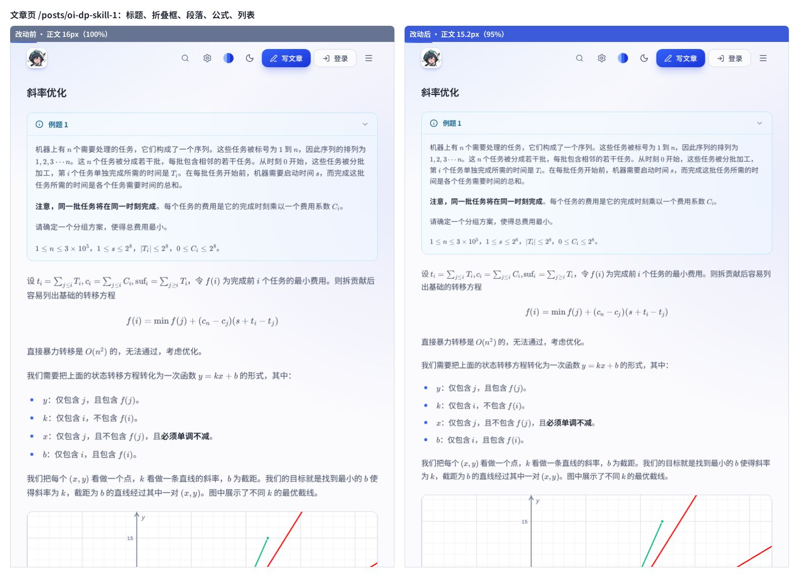

# 2026-11-11 · 正文字号 95% —— 测试结果

对应改动：`ChangeLog.md` 的「2026-11-11 · 正文字号调整为原来的 95%」。

## 结论

| 检查项 | 结果 |
| --- | --- |
| `npm run build`（`tsc --noEmit` + `vite build`） | 通过 |
| `npm test` · Web 特性测试（`scripts/test-features.mjs`） | 13 组全部通过 |
| `npm test` · VS Code 插件回归（`npm run extension:test`） | 76 项：72 通过、0 失败、4 项真实浏览器测试按默认跳过（新增 1 项「正文字号缩放」） |
| 真实 Chromium 对照（`npm --prefix vscode_extensions/v1 run test:browser`） | 4 项全部通过：深浅色下博客与插件预览的计算样式逐项一致 |
| `npm --prefix vscode_extensions/v1 run typecheck` | 通过 |
| `npm run build:offline`（含 `scripts/verify-offline.mjs`） | 通过：3.22 MB、16 篇内置文章、无外链；已同步 `offline/index.html` |
| 改动前后逐元素字号对比（真实 Chromium） | 17 个页面 / 场景、8595 个含文字的元素，**0 个不符合预期** |

## 逐元素字号对比

**方法**：改动前（`317380d`）与改动后各做一次 `npm run build`，用同一个 headless Chromium 分别打开两份产物的同一页面，
展开全部折叠框后，读取 `<main>` 内每个「自身含文字」的元素（以及表单控件）的 `getComputedStyle().fontSize`，按 DOM 顺序一一配对，计算 改动后 / 改动前。

**覆盖**：13 篇公开文章 + 帮助页（3 篇加密文章不渲染正文，未计入），另加全站字号偏好 80% / 110% / 130% 三个场景。

**预期与结果**（完整原始输出见 [computed-font-sizes.md](computed-font-sizes.md)）：

| 元素 | 预期倍率 | 实测（全站字号 100%） |
| --- | --- | --- |
| 正文段落 / 列表 / 引用 | 0.95 | 16 → 15.2px |
| 正文标题 h2 / h3 / h4 | 0.95 | 24 → 22.8px、20 → 19px、16 → 15.2px |
| 行内代码 | 0.95 | 14 → 13.3px |
| 表格（含折叠框里的表格） | 0.95 | 16 → 15.2px |
| KaTeX 公式（行内 / 行间 / 上下标） | 0.95 | 16.8 → 15.96px、17.92 → 17.024px 等 |
| 折叠框标题 | 0.95 | 14 → 13.3px |
| 折叠框内容 | 0.95 | 14.5 → 13.775px |
| 交互展示框里的正文 | 0.95 | 15.2 → 14.44px |
| 选择框选项 / 控件标题 | 0.95 | 14.5 → 13.775px、14 → 13.3px |
| 代码块 | 1（不变） | 11.8125 → 11.8125px |
| 代码语言标签、展示框变量栏、选项序号等角标 | 1（不变） | 11 → 11px、12 → 12px |
| 直角坐标系 / 图论画布标注（SVG） | 1（不变） | 10 → 10px、12 → 12px |
| 正文之外：文章标题、摘要、元信息、目录、返回链接等 | 1（不变） | 41.6px、15.5px、14px、13px、12px 均不变 |

合计 8595 个元素：7546 个变为原来的 0.95 倍，1049 个保持不变，没有出现其它倍率。

> 原始输出里「展示框标题栏 / 变量栏 ×0.95（16 → 15.2px）」的那 1 个元素是变量滑动条 `<input type="range">`：
> 它不显示文字，只是继承了正文字号，尺寸用的是 `rem`（`h-2`），外观没有变化；变量栏里看得见的文字都是 12px，未变。

全站字号偏好不为 100% 时，`rem` 字号先随偏好缩放、再乘 0.95（如 110% 时正文 17.6 → 16.72px），
折叠框内容这类 `px` 字号与改动前一样不随偏好变化（14.5 → 13.775px）。

**离线单文件版**：用 `file://` 直接打开 `offline/index.html` 的文章页，`--prose-font-scale` 为 `.95`，
正文 15.2px、表格 15.2px、折叠框标题 13.3px / 内容 13.775px、展示框正文 14.44px，页面标题 41.6px 不变，全程 0 个外网请求。

## 截图

改动前后并排对比，同一视口宽度（760px）、同一滚动锚点：

- [compare-article.jpg](compare-article.jpg)：文章页——标题、折叠框、段落、公式、列表都按比例变小，页头与坐标系不变。
- [compare-table-code.jpg](compare-table-code.jpg)：帮助页——段落与表格变小，代码块字号不变。

> 说明：测试沙箱里没有中文字体，截图时临时注入了 Noto Sans SC 与 Cascadia Code，只影响字形观感，不影响字号；
> 实际站点仍按访客设备上的字体栈显示。

## 环境

- Node v22.22.3、npm 10.9.8，Debian 12（x86_64）。
- 浏览器：Chromium 153.0.8010.0（headless shell），由 `playwright-core` 1.64.0 驱动。浏览器只在本机临时下载用于验证，没有加入仓库依赖。
- 插件的 4 项真实浏览器测试在仓库里默认跳过，需要设置 `BROWSER_EXECUTABLE_PATH` 才会运行；本次手动设置后跑通。

## 顺带观察到的既有现象（本次未改动）

代码块里的文字实际渲染为 **11.8125px**，而不是 `.prose pre` 写的 13.5px：`@tailwindcss/typography` 的
`.prose-base :where(code)`（`0.875em`）输出在 `.prose :where(pre code){font-size:inherit}` 之后且优先级相同，
于是 `pre` 里的 `code` 又被缩了一次（13.5 × 0.875）。改动前后都是如此，这次保持原样；是否要让代码块回到 13.5px 需要另行决定。
