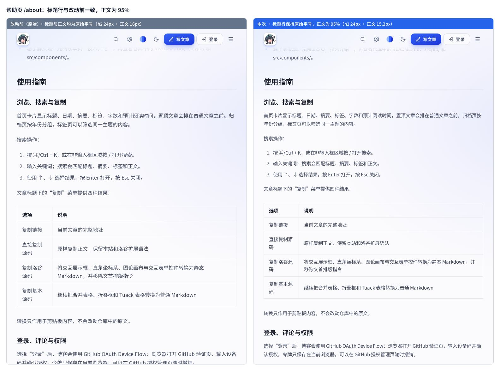
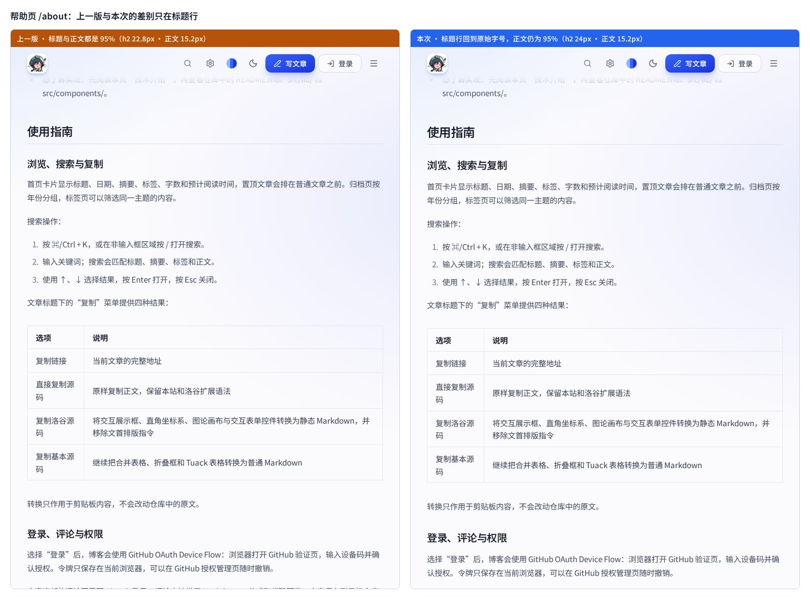
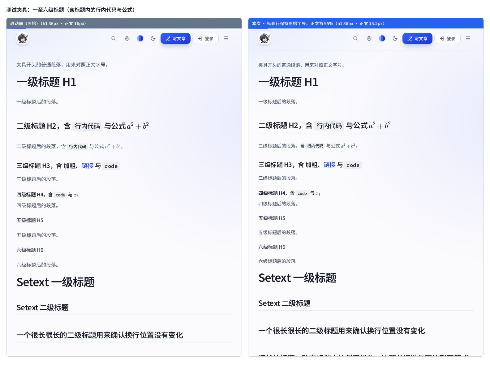

# 2026-11-12 · 标题行保持原始字号 —— 测试结果

对应改动：`ChangeLog.md` 的「2026-11-12 · 标题行保持原始字号，不随正文缩放」。

上一次更新（`Test/2026-11-11-prose-font-scale/`）把 Markdown 正文整体缩到 95%，标题也跟着变小了。
这次让**标题行（`#` – `######`，即 h1–h6）回到 95% 调整之前的字号**，其余正文仍是 95%。

## 结论

| 检查项 | 结果 |
| --- | --- |
| `npm run build`（`tsc --noEmit` + `vite build`） | 通过 |
| `npm test` · Web 特性测试（`scripts/test-features.mjs`） | 13 组全部通过 |
| `npm test` · VS Code 插件回归（`npm run extension:test`） | 77 项：73 通过、0 失败、4 项真实浏览器测试按默认跳过（新增 1 项「标题行不参与正文字号缩放」） |
| 真实 Chromium 对照（`npm --prefix vscode_extensions/v1 run test:browser`） | 4 项全部通过：深浅色下博客与插件预览的计算样式逐项一致（含 `.prose h1`、`.prose h2`） |
| `npm --prefix vscode_extensions/v1 run typecheck` | 通过 |
| `npm run build:offline`（含 `scripts/verify-offline.mjs`） | 通过：3.22 MB、16 篇内置文章、无外链；已同步 `offline/index.html` |
| 博客 · 三方逐元素对比（真实文章 + 帮助页） | 17 个页面 / 场景、8595 个含文字的元素，**0 个不符合预期**；197 个标题行全部与原始一致 |
| 博客 · 测试夹具（一至六级标题 × 各种容器） | 3 个场景、387 个元素、81 个标题行，**0 个不符合预期** |
| VS Code 预览 · 同一份夹具 | 深色、浅色各 106 个元素、27 个标题行，**0 个不符合预期** |
| 离线单文件版（`file://`） | 标题 24px / 20px / 16px，正文 15.2px，0 个外网请求 |
| 新增用例的变异检查 | 5 种「改坏」的写法全部被拦住 |

## 三方逐元素对比

**方法**：准备三份构建——**原始**（`317380d`，95% 调整之前）、**上一版**（`f46bcb3`，标题与正文都是 95%）、**本次**。
用同一个 headless Chromium 分别打开三份产物的同一页面，展开全部折叠框后，读取 `<main>` 内每个「自身含文字」的元素
（以及表单控件）的 `getComputedStyle().fontSize`，按 DOM 顺序一一配对；对每个标题行再额外比较行高、上下外边距、
下内边距、字距、字重和盒子高度。

**预期**：标题行以及标题里的行内代码、公式 —— 与原始相同（相对上一版 ÷0.95）；其余正文 —— 原始的 0.95 倍（与上一版相同）；
代码块、角标、SVG 标注、正文之外的界面文字 —— 三份都相同。

**覆盖**：13 篇公开文章 + 帮助页（3 篇加密文章不渲染正文，未计入），另加全站字号偏好 80% / 110% / 130% 三个场景。
真实文章里只出现了二至四级标题，所以另外准备了一份夹具（[heading-fixture.md](heading-fixture.md)）覆盖一至六级标题、
Setext 写法、原始 HTML 标题、很长的标题，以及标题出现在引用、列表、折叠框（含嵌套）、展示框、选择框 / 是否框、
手写 `not-prose` 容器里的情况。夹具只在验证时临时放进 `content/posts/`，没有进入仓库的文章目录。

**结果**（全站字号 100%，单位 px；完整原始输出见 [computed-font-sizes.md](computed-font-sizes.md)）：

| 元素 | 原始 | 上一版 | 本次 | 本次相对原始 |
| --- | --- | --- | --- | --- |
| 标题行 h1 | 36 | 34.2 | **36** | 不变 |
| 标题行 h2 | 24 | 22.8 | **24** | 不变 |
| 标题行 h3 | 20 | 19 | **20** | 不变 |
| 标题行 h4 / h5 / h6 | 16 | 15.2 | **16** | 不变 |
| 折叠框里的 h2 / h3 / h4–h6 | 21.75 / 18.125 / 14.5 | 20.663 / 17.219 / 13.775 | **21.75 / 18.125 / 14.5** | 不变 |
| 展示框里的标题 | 15.2 | 14.44 | **15.2** | 不变 |
| 选择框 / 是否框里的标题 | 14.5 | 13.775 | **14.5** | 不变 |
| 手写 `not-prose` 容器里的标题 | 16 | 15.2 | **16** | 不变 |
| h2 里的行内代码 / 公式 | 21 / 25.2 | 19.95 / 23.94 | **21 / 25.2** | 不变 |
| 正文段落 / 列表 / 引用 | 16 | 15.2 | 15.2 | ×0.95 |
| 行内代码 | 14 | 13.3 | 13.3 | ×0.95 |
| 表格（含表头） | 16 | 15.2 | 15.2 | ×0.95 |
| KaTeX 公式（行内） | 16.8 | 15.96 | 15.96 | ×0.95 |
| 折叠框标题栏 / 内容 | 14 / 14.5 | 13.3 / 13.775 | 13.3 / 13.775 | ×0.95 |
| 交互展示框里的正文 | 15.2 | 14.44 | 14.44 | ×0.95 |
| 代码块 | 11.8125 | 11.8125 | 11.8125 | 不变 |
| 角标、SVG 标注、正文之外的界面文字 | — | — | — | 不变 |

标题行的盒子也回到了原始值，例如：

| 标题 | 行高（原始 → 上一版 → 本次） | 上 / 下间距（原始 → 上一版 → 本次） |
| --- | --- | --- |
| h1 | 40 → 38 → 40 | 0 / 32 → 0 / 30.4 → 0 / 32 |
| h2 | 32 → 30.4 → 32 | 48 / 24 → 48 / 22.8 → 48 / 24 |
| h3 | 32 → 30.4 → 32 | 32 / 12 → 30.4 / 11.4 → 32 / 12 |
| h4 | 24 → 22.8 → 24 | 24 / 8 → 22.8 / 7.6 → 24 / 8 |

合计：

- 真实文章与帮助页：8595 个元素 = 标题行内 197 个与原始相同 + 其余正文 7349 个为原始的 0.95 倍 + 1049 个保持不变，
  没有其它倍率。197 个标题行（h2 ×102、h3 ×80、h4 ×15）的字号、行高、上下间距、盒子高度全部与原始一致。
  上一次更新统计的「7546 个 ×0.95」正好拆成这次的 7349 + 197。
- 夹具：387 个元素 = 标题行内 150 个 + 其余正文 132 个 + 不变 105 个；81 个标题行（h1 ×6、h2 ×21、h3 ×21、h4 ×9、h5 ×15、h6 ×9）
  全部与原始一致。

全站字号偏好不为 100% 时同样成立：130% 时 h3 为 26 → 24.7 → 26px、正文 20.8 → 19.76 → 19.76px；
80% 时 h4 为 12.8 → 12.16 → 12.8px。折叠框内容是 `px` 字号，里面的标题不随偏好变化（h2 始终 21.75px）。

> 一处意料之中的细微差别：写在**引用、列表里**的标题，字号、行高、间距、盒子高度都与原始一致，
> 但盒子比原始宽了约 0.8px（引用）/ 1.6px（列表）、文字相应靠左一点——因为引用的内边距和列表的缩进是按正文字号算的，
> 正文缩到 95% 后缩进略减。真实文章里没有这种写法，只在夹具里出现。

## VS Code 预览

用三份插件构建分别在模拟的 VS Code Webview 里渲染同一份夹具（带 VS Code 内置 `markdown.css` 的干扰，
搭法与 `test/browser.test.mjs` 相同）。深色、浅色结果相同：106 个元素里标题行内 50 个与原始相同、其余正文 44 个为 0.95 倍、
12 个不变；27 个标题行的字号、行高、上下间距、盒子高度全部与原始一致（h1 36px、h2 24px、h3 20px、h4–h6 16px）。

## 离线单文件版

`file://` 直接打开 `offline/index.html`：`--prose-font-scale` 为 `.95`，正文 15.2px；标题 h2 24px、h3 20px、h4 16px，
折叠框里的 h2 21.75px；页面标题 41.6px 不变；全程 0 个外网请求、0 个页面报错。
与上一版的离线文件逐条规则比较，差别只有 19 条标题字号规则（12 条改写、6 条新增的 h5 / h6、1 条 `not-prose` 规则）。

## 回归用例与变异检查

`vscode_extensions/v1/test/styles.test.mjs` 新增用例「标题行不参与正文字号缩放」：博客与插件两份生成样式里，
`.prose` / `.prose-base` / `.prose-sm` 的 h1–h6 字号都必须是 `calc(原倍数 / var(--prose-font-scale))`，
`not-prose` 容器内标题的那条规则必须存在且为 `calc(1em / var(--prose-font-scale))`。

为确认这个用例真的拦得住，临时把代码改坏再跑（每次跑完都恢复原样）：

| 改坏的方式 | 用例结果 |
| --- | --- |
| `tailwind.config.js` 退回上一版（标题跟随正文缩放） | 失败：`.prose` 里 h1 的字号 |
| 去掉 `prose-sm` 的 h5 | 失败：`.prose-sm` 里 h5 的字号 |
| 把「除以系数」误写成「乘以系数」 | 失败：`.prose` 里 h1 的字号 |
| 删掉 `index.css` 里 `not-prose` 容器的标题规则 | 失败：not-prose 容器内标题的字号 |
| `not-prose` 标题规则漏掉 h6 | 失败：not-prose 容器内标题的字号 |

## 截图

并排对比，同一视口宽度（760px）、同一滚动锚点：

- [compare-original.jpg](compare-original.jpg)：帮助页，**原始 vs 本次**——二级、三级标题大小一致，段落、列表、表格变小。
- [compare-previous.jpg](compare-previous.jpg)：帮助页，**上一版 vs 本次**——正文完全相同，只有标题变回原来的大小。
- [compare-heading-levels.jpg](compare-heading-levels.jpg)：夹具，**原始 vs 本次**——一至六级标题（含标题里的行内代码与公式）。

> 说明：测试沙箱里没有中文字体，截图时临时注入了 Noto Sans SC 与 Cascadia Code，只影响字形观感，不影响字号；
> 实际站点仍按访客设备上的字体栈显示。

## 环境

- Node v22.22.3、npm 10.9.8，Debian 12（x86_64）。
- 浏览器：Chromium 153.0.8010.0（headless shell），由 `playwright-core` 1.64.0 驱动。浏览器只在本机临时下载用于验证，没有加入仓库依赖。
- 插件的 4 项真实浏览器测试在仓库里默认跳过，需要设置 `BROWSER_EXECUTABLE_PATH` 才会运行；本次手动设置后跑通。
- 三方对比用的静态服务器与测量脚本是临时文件，没有进入仓库。
